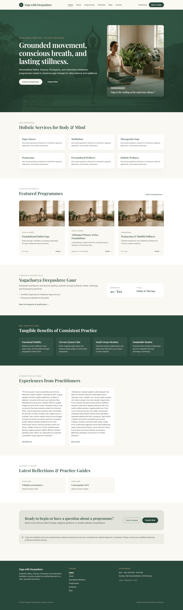
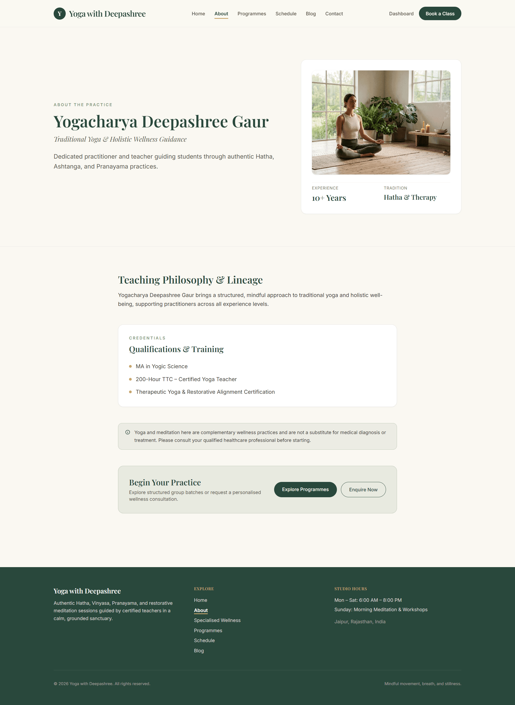
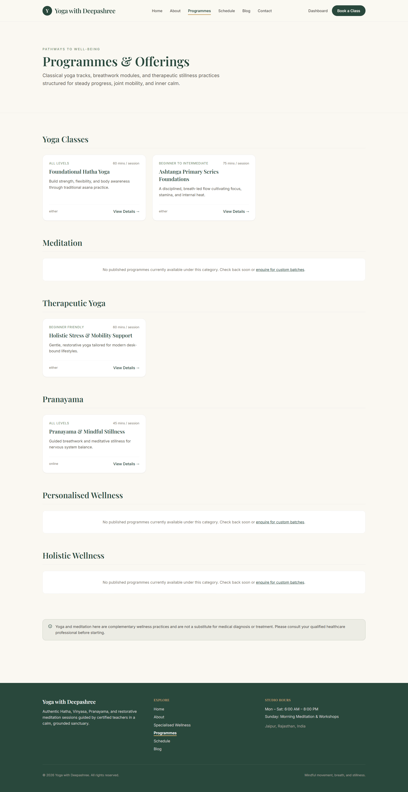
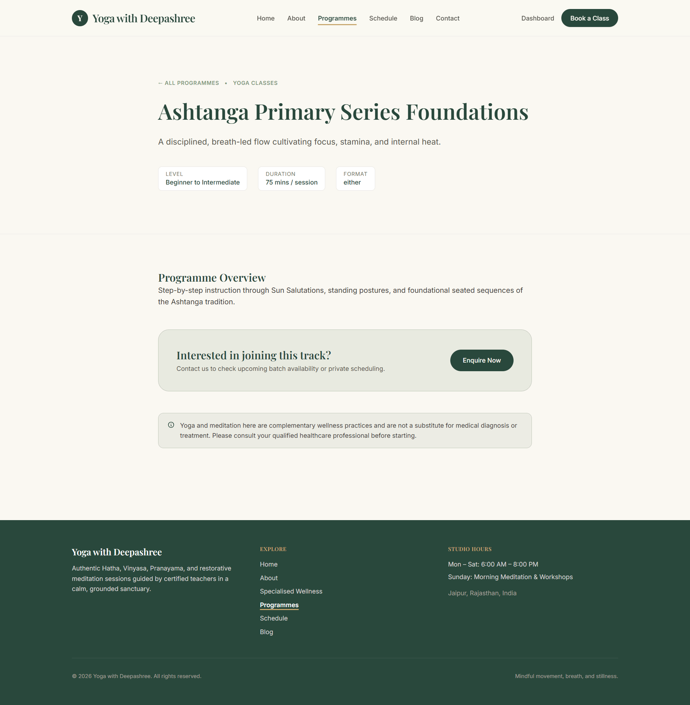
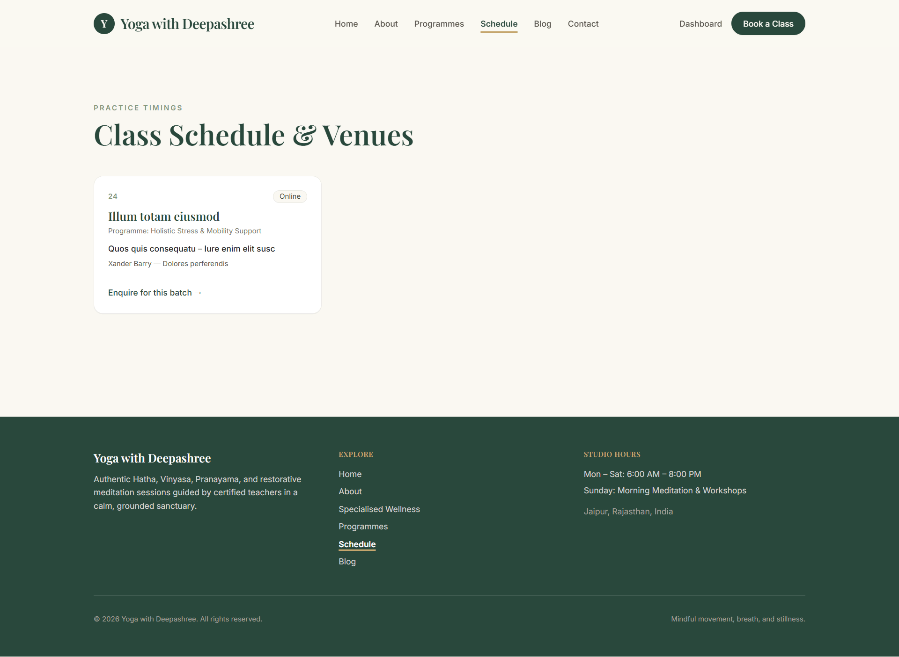
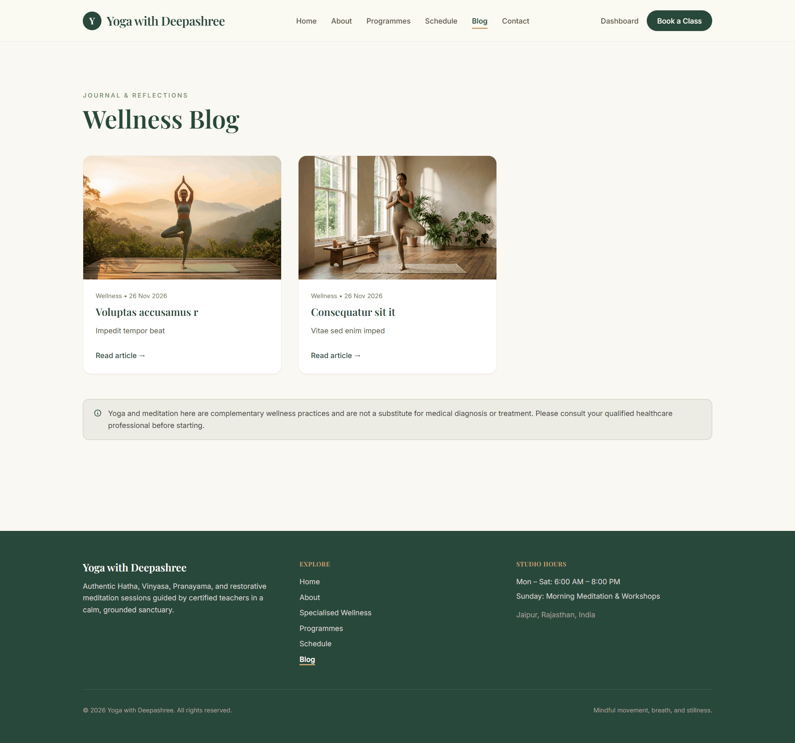
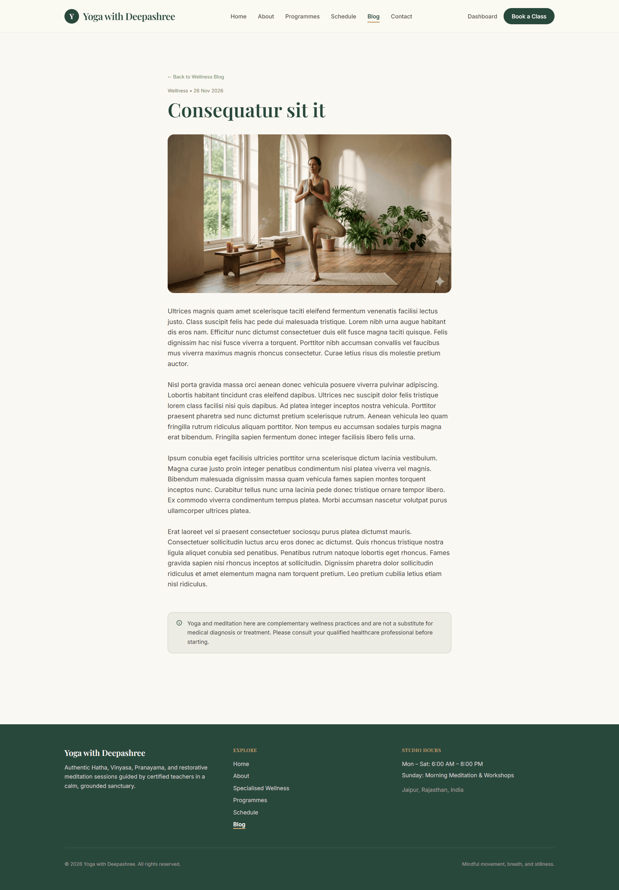

# Yoga with Deepashree

A yoga and holistic-wellness website built with Laravel, Livewire, and Blade. It includes a public programme and class-booking experience, plus an authenticated area for managing instructor information, media, and staff access.

## Features

### Public website

- Homepage with studio offerings, featured programmes, instructor information, and enquiry links
- About and specialised-wellness pages
- Programme catalogue grouped by category, with individual programme details
- Class schedule and public booking-request form
- Wellness blog with article pages, plus public gallery and testimonials
- Contact page, canonical metadata, `robots.txt`, and `sitemap.xml`

### Admin area

- Authenticated admin area at `/admin`
- Management for programmes, class schedules, blog posts, testimonials, gallery items, and enquiries
- Instructor profile editor for biography, qualifications, portrait, and publication status
- Media library for uploading, browsing, copying URLs, and deleting images
- Staff directory and staff creation, restricted by the `manage-staff` permission
- Standard account settings and authentication features from the Laravel starter kit

Booking requests can be submitted from the public website. Admin booking review and management are not currently implemented.

## Screenshots

The following captures are from `public/images/Screens` and show the public website with local application content.

<p>
  
</p>

<p>
  
</p>

<p>
  
</p>

<p>
  
</p>

<p>
  
</p>

<p>
  
</p>

<p>
  
</p>

## Stack and tools

- PHP 8.3+ and Laravel 13
- Livewire 4, Blade, and Flux UI
- Tailwind CSS 4 and Vite Plus for frontend assets
- MySQL by default in `.env.example`; tests use in-memory SQLite
- Pest for tests, Pint for formatting, and Larastan/PHPStan for static analysis

## Setup

Requirements: PHP 8.3+, Composer, Node.js/npm, and a MySQL server (or another database configured in `.env`).

1. Clone the repository and open the project directory.
2. Create the database configured by `DB_DATABASE` in `.env.example` (default: `yoga_website`).
3. Copy `.env.example` to `.env` and set the database connection details:

   ```sh
   cp .env.example .env
   ```

   In Windows PowerShell, use `Copy-Item .env.example .env`.
4. Install dependencies, generate the application key, migrate the database, and build frontend assets:

   ```sh
   composer setup
   ```

   The setup script creates `.env` if it does not exist. Configure the database before running it.
5. To load local sample content and create the owner account, set `OWNER_NAME`, `OWNER_EMAIL`, and a unique `OWNER_PASSWORD` in `.env`, then run:

   ```sh
   php artisan db:seed
   ```

   Seeding is intended for local development; do not use development seed data in production.
6. Start the local application:

   ```sh
   composer run dev
   ```

Sign in with the owner email and password configured for the seeder to access the admin area.

## Admin workflows

After signing in with an active account:

1. Open `/admin` to enter the admin area.
2. Open `/admin/profile` to update the instructor biography, qualifications, portrait, and public visibility.
3. Open `/admin/media` to upload supported images, copy their public URLs, or delete them.
4. Users with the `manage-staff` permission can open `/admin/staff` to view the staff directory and create staff accounts.

## Useful commands

| Command | Purpose |
| --- | --- |
| `composer run dev` | Run Laravel, the queue listener, and Vite for development |
| `composer setup` | Install dependencies, initialize the app, migrate, and build assets |
| `npm run build` | Build production frontend assets |
| `composer ci:check` | Run Pint checks, PHPStan, and the Pest suite |
| `composer test` | Run the project's combined checks and tests |
| `php artisan route:list` | Inspect registered application routes |

## Structure and conventions

- `routes/web.php` defines public routes and the admin middleware group.
- `routes/admin.php` defines admin, instructor profile, media, and staff routes.
- `routes/settings.php` contains authenticated account settings and the passkey discovery route.
- `app/Http/Controllers` and `app/Http/Requests` contain HTTP controllers and request validation.
- `app/Models` contains Eloquent models; Livewire features and reusable Blade views follow the existing Laravel and Livewire patterns.
- `public/assests` contains the supplied brand logos, icons, favicons, and web manifest. The directory name is intentionally kept as it exists in the project.
- `public/images/Screens` contains the public-page screenshots used above.
- Keep credentials in the local `.env`; never commit environment secrets.

## SEO and production configuration

The application generates canonical URLs from `APP_URL`. `/sitemap.xml` currently lists the homepage only; add other public pages there when they are intended to be indexed. `/robots.txt` points to the sitemap and excludes dashboard, settings, and technical endpoints.

Set `APP_URL` to the canonical production origin and `APP_NAME` to the public site name before launch. The repository has a GitHub Actions checks workflow but no deployment platform configuration or automated deployment workflow.

## Community and licensing

See [CONTRIBUTING.md](CONTRIBUTING.md) for contribution guidance, [CODE_OF_CONDUCT.md](CODE_OF_CONDUCT.md) for community expectations, [SECURITY.md](SECURITY.md) for vulnerability reporting, and [LICENSE](LICENSE) for license terms.
